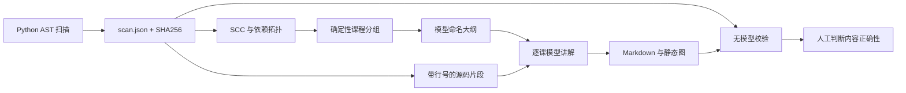

# 数据流与边界

`scanner.py` 只读取源码，不执行目标代码。JSON Schema 随 wheel 打包：
`src/repo_tutor/scan.schema.json`。节点 ID 包含文件、限定名称及声明行，保留 overload 声明；
调用目标取最后绑定的同名定义。公开节点按名称判断，不读取 `__all__` 推断导出表。
入口来自 `__main__` 守卫、route/get/post 等装饰器、command/group 装饰器和 pyproject scripts；另标记公开类的 `__init__`，以及参数名匹配 WSGI/ASGI 协议的 `__call__`。
装饰器基于名称启发式识别，不证明它属于特定 Web 框架。

`graph.py` 的边从使用者指向依赖，迭代式 SCC 合并节点环后做依赖优先的稳定拓扑排序。
`topology.json` 保留完整调用/继承/import 图与有界入口可达集合，显式标记截断；不是运行轨迹。

`curriculum.py` 先按模块聚类，再沿同模块调用/继承边计算最近路由/协议入口（距离、稳定 ID 打破平局），分离流程子图。其余功能、构造器和 CLI 留在各自模块。跨聚类的真实节点 SCC 单独作为不可拆的循环功能；仅把少量环内节点放在一起，不连带混合两个模块的全部功能。
课程的先后由调用/继承边组成的商图拓扑决定；import 边保留在模块地图中，避免类型导入和模块加载环把所有功能课变成同一先修组。商图环内的课程标记同一个共同先修 cohort，稳定顺序不声称严格先修。大组按节点 SCC 单元拆分，`nodes_per_lesson` 是软上限。

功能课的 `node_ids` 按依赖顺序保存，公开符号与入口恰好归属一次。`reading_order` 从入口开始，按源码调用位置做 DFS，包含可用私有助手；没有入口的流程按源码位置补充阅读根。它服务正文讲解顺序，与速查表的依赖顺序各司其职。
00 选取最大的协议入口子图；没有协议入口时退回非构造入口，再退回任意入口。没有可识别入口时，导读仅能说明模块和已扫描定义，不能编造生命周期。

`course.py` 生成 schema v2 计划骨架，模型仅命名；读取计划时重算归属、顺序、阅读路径和配置，不匹配就拒绝。旧 v1 计划需要新目录重新生成。
课文向模型提供带行号的有限源码片段、docstring 与已解析边；超上下文直接停止。模型返回目标、多个符号支持的连续段落、两道附答案的自测及衔接。每段引用必须来自本次提供的证据白名单；速查表由程序填满全部所属关键节点。

`diagrams.py` 只从扫描节点生成 Mermaid；稳定 ID 取节点身份 SHA256 的前 16 个十六进制字符。功能图最多显示前 20 个阅读节点及其调用/继承边，00 同时显示模块 import 地图。校验器接受固定声明与边语法，核对每个声明的身份/标签及所有端点，空图、未知语法和不完整围栏都拒绝。节点真实不证明边的运行语义。

`model.py` 走 OpenAI 兼容 Chat Completions JSON 模式。API 请求前在 `usage.json` 记账，
失败也占预算，无自动重试。POSIX 文件锁串行化共用输出目录的调用；原始响应不落仓库，
账本保存请求/返回模型名、用量和状态，不保存密钥或请求正文。API 成功与课程渲染成功是两个阶段。
当前实现适用于 macOS/Linux。

`verify.py` 校验当前源码与扫描快照的 SHA256，逐条检查引用路径、行号和附近声明。
覆盖统计仅认课文中的有效符号引用；大纲和 README 不计入。
无引用正文检查仍是启发式，不是语义事实提取器。课文必须具备五段结构、2–3 个目标、2 个问题与答案、图和第 0 课。讲解引用、严格仅速查表引用和其他位置引用分别统计；只认有效引用，代码围栏和图不贡献出现覆盖。
`passed` 要求覆盖、引用、源码快照、扫描诊断和课文检查均通过，仍需要人工看内容。

CLI 写本地输出目录；MCP 只读源码及已有课文，不调用模型、不写文件。
MCP 的校验直接扫描当前源码，因此不做历史快照漂移判断；需要漂移判断时使用 CLI。

# 失败与恢复

- 解析失败/编码失败/大文件：进入扫描 diagnostics；校验不能报告通过。
- 无密钥、超预算、超上下文或非法模型输出：停止当前生成，返回退出码 2，保留已有课文。
- 重跑 `all` 复用匹配扫描快照的大纲，跳过已存在课文；如源码变化而大纲不匹配，拒绝继续。
- 验证未通过返回 1。只生成部分课文时，漏讲列表是预期结果，不能当作完整课程通过。
- 修改配置导致分组变化时，用新的输出目录；现存 plan 的节点归属属于已有课程契约。
- 删除课文文件后重跑 `write` 会重新调用模型，仍受该目录的累计预算限制。

# 一手参考

- [Python ast](https://docs.python.org/3/library/ast.html)
- [DeepSeek Chat Completions](https://api-docs.deepseek.com/api/create-chat-completion/)
- [MCP tools 与 annotations](https://modelcontextprotocol.io/specification/2025-06-18/server/tools)
