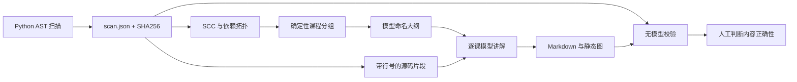

# 数据流与边界

`scanner.py` 只读取源码，不执行目标代码。JSON Schema 随 wheel 打包：
`src/repo_tutor/scan.schema.json`。节点 ID 包含文件、限定名称及声明行，保留 overload 声明；
调用目标取最后绑定的同名定义。公开节点按名称判断，不读取 `__all__` 推断导出表。
入口来自 `__main__` 守卫、route/get/post 等装饰器、command/group 装饰器和 pyproject scripts。
装饰器基于名称启发式识别，不证明它属于特定 Web 框架。

`graph.py` 的边从使用者指向依赖，迭代式 SCC 合并环后做依赖优先的稳定拓扑排序。
同一拓扑层按稳定 ID 排序，环内同样按 ID 排序。课程只选择入口与公开类/函数，按可配置数量分组。
环可能跨课，环内不存在严格先修保证。`topology.json` 的 flows 由每个入口出发沿已解析边做有界遍历，
显式标记截断。这是静态可达集合，不是运行时的先后顺序。

`course.py` 先确定节点归属和顺序，再让模型给课程命名。逐课提供有限、编号的定义头部及执行体片段；
超限直接报错，不静默截断整个请求。模型必须逐一返回所属节点的讲解，程序为每段附上明确符号和定义行。
图仅画本课内已解析关系，孤立节点不代表运行时无联系。

`model.py` 走 OpenAI 兼容 Chat Completions JSON 模式。API 请求前在 `usage.json` 记账，
失败也占预算，无自动重试。POSIX 文件锁串行化共用输出目录的调用；原始响应不落仓库，
账本保存请求/返回模型名、用量和状态，不保存密钥或请求正文。API 成功与课程渲染成功是两个阶段。
当前实现适用于 macOS/Linux。

`verify.py` 校验当前源码与扫描快照的 SHA256，逐条检查引用路径、行号和附近声明。
覆盖统计仅认课文中的有效符号引用；大纲和 README 不计入。
无引用正文与缺少 mermaid 的检查只是启发式，不是语义事实提取器。
`passed` 要求覆盖、引用、源码快照、扫描诊断和课文检查均通过，仍需要人工看内容。

CLI 写本地输出目录；MCP 只读源码及已有课文，不调用模型、不写文件。
MCP 的校验直接扫描当前源码，因此不做历史快照漂移判断；需要漂移判断时使用 CLI。

# 失败与恢复

- 解析失败/编码失败/大文件：进入扫描 diagnostics；校验不能报告通过。
- 无密钥、超预算、超上下文或非法模型输出：停止当前生成，返回退出码 2，保留已有课文。
- 重跑 `all` 复用匹配扫描快照的大纲，跳过已存在课文；如源码变化而大纲不匹配，拒绝继续。
- 验证未通过返回 1。只生成部分课文时，漏讲列表是预期结果，不能当作完整课程通过。
- 修改配置导致分组变化时，用新的输出目录；现存 plan 的节点归属属于已有课程契约。
- 删除课文文件后重跑 `write` 会重新调用模型，仍受该目录的累计预算限制。

# 一手参考

- [Python ast](https://docs.python.org/3/library/ast.html)
- [DeepSeek Chat Completions](https://api-docs.deepseek.com/api/create-chat-completion/)
- [MCP tools 与 annotations](https://modelcontextprotocol.io/specification/2025-06-18/server/tools)
