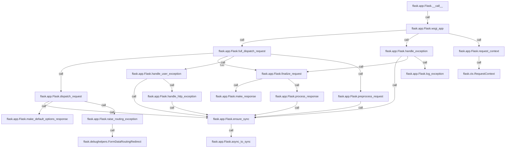

# 00 · Flask 全局导览：WSGI 应用、请求生命周期与模块分工

> 模型生成，需人工审阅。静态推断：可达关系与源码顺序不等于运行轨迹；动态分派仍需运行验证。

## 学习目标

- 理解 Flask 作为 WSGI 应用的中心对象如何被服务器调用，以及 `__call__` 与 `wsgi_app` 的分工。 [Flask.__call__](src/flask/app.py:1529)
- 掌握一次请求从创建并压入 RequestContext、预处理、视图分发、异常处理到响应最终化与上下文弹出的完整生命周期。 [Flask.__call__](src/flask/app.py:1529)
- 认识 CLI、配置、蓝图、会话、模板、测试等模块在整体系统中的角色与边界。 [Flask.__call__](src/flask/app.py:1529)

## 按调用顺序理解

### 系统做什么

Flask 的核心是一个 WSGI 应用对象：`Flask` 类被文档描述为“实现 WSGI 应用并充当中心对象”，创建后作为视图函数、URL 规则、模板配置等的中央注册表，其构造参数是模块或包名，用于定位资源。`flask/__init__.py` 把 `Flask`、`Blueprint`、`json` 等从各子模块重新导出，构成对外公共入口；`flask/typing.py` 提供共享类型别名，被 app、ctx、sansio 等模块导入，形成类型层的基础。 [Flask](src/flask/app.py:81) [<module>](src/flask/__init__.py:1) [<module>](src/flask/typing.py:1)

### 有哪些入口

系统有两个主要入口。其一是 WSGI 协议入口：WSGI 服务器把应用对象当可调用对象调用，`Flask.__call__` 的文档明确它转调 `wsgi_app`，而 `wsgi_app` 单独实现正是为了让中间件可以包装 `app.wsgi_app` 而不丢失原应用对象。其二是命令行入口：`flask/__main__.py` 导入并调用 `cli.main`，`cli.py` 末尾的 `__main__` 块同样调用 `main`，`main` 再调用 `cli.main()`；CLI 提供 `run_command`（本地开发服务器）、`shell_command`（应用上下文中的交互式 shell）和 `routes_command`（列出已注册路由）等命令。 [Flask.__call__](src/flask/app.py:1529) [Flask.wsgi_app](src/flask/app.py:1479) [<module>](src/flask/__main__.py:1) [main](src/flask/cli.py:1130) [<main@1134>](src/flask/cli.py:1134) [run_command](src/flask/cli.py:943) [shell_command](src/flask/cli.py:1009) [routes_command](src/flask/cli.py:1069)

### 模块地图

```mermaid
flowchart TD
  n82092c8e40ec4124["flask.&lt;module&gt;"]
  nb4537f0e430d3476["flask.__main__.&lt;module&gt;"]
  na42178aa1e29fbae["flask.app.&lt;module&gt;"]
  n3435a2b8d10880aa["flask.blueprints.&lt;module&gt;"]
  na3dc7d966a7ee2ea["flask.cli.&lt;module&gt;"]
  n4cc259a80781e179["flask.config.&lt;module&gt;"]
  n48144f77ffd2b5b3["flask.ctx.&lt;module&gt;"]
  n6e082f456dc48b09["flask.debughelpers.&lt;module&gt;"]
  n41fbc53d53022d86["flask.globals.&lt;module&gt;"]
  n363cd9366a41323e["flask.helpers.&lt;module&gt;"]
  na8dba109a26abd05["flask.json.&lt;module&gt;"]
  nd350bf79d42ab5dd["flask.json.provider.&lt;module&gt;"]
  n0455655a69f41856["flask.json.tag.&lt;module&gt;"]
  n0c0f15df18f362d0["flask.logging.&lt;module&gt;"]
  n0c779dfa804f9797["flask.sansio.app.&lt;module&gt;"]
  n5a14e549b28f1dd4["flask.sansio.blueprints.&lt;module&gt;"]
  n7acaeb491fe1c6cc["flask.sansio.scaffold.&lt;module&gt;"]
  n9802b39ac23fe3d0["flask.sessions.&lt;module&gt;"]
  ncc2e78acc333c15c["flask.signals.&lt;module&gt;"]
  n1ef900348dfcb52b["flask.templating.&lt;module&gt;"]
  n1bf33b4c50c8a5b6["flask.testing.&lt;module&gt;"]
  n1ddd94a0e0b6ffd3["flask.typing.&lt;module&gt;"]
  n727539a33f20505f["flask.views.&lt;module&gt;"]
  nf299b8b427ad18c2["flask.wrappers.&lt;module&gt;"]
  n82092c8e40ec4124 -->|import| na42178aa1e29fbae
  n82092c8e40ec4124 -->|import| n3435a2b8d10880aa
  n82092c8e40ec4124 -->|import| n4cc259a80781e179
  n82092c8e40ec4124 -->|import| n48144f77ffd2b5b3
  n82092c8e40ec4124 -->|import| n363cd9366a41323e
  n82092c8e40ec4124 -->|import| na8dba109a26abd05
  n82092c8e40ec4124 -->|import| n1ef900348dfcb52b
  n82092c8e40ec4124 -->|import| nf299b8b427ad18c2
  nb4537f0e430d3476 -->|import| na3dc7d966a7ee2ea
  na42178aa1e29fbae -->|import| na3dc7d966a7ee2ea
  na42178aa1e29fbae -->|import| n48144f77ffd2b5b3
  na42178aa1e29fbae -->|import| n6e082f456dc48b09
  na42178aa1e29fbae -->|import| n363cd9366a41323e
  na42178aa1e29fbae -->|import| n0c779dfa804f9797
  na42178aa1e29fbae -->|import| n9802b39ac23fe3d0
  na42178aa1e29fbae -->|import| n1ef900348dfcb52b
  na42178aa1e29fbae -->|import| n1bf33b4c50c8a5b6
  na42178aa1e29fbae -->|import| n1ddd94a0e0b6ffd3
  na42178aa1e29fbae -->|import| nf299b8b427ad18c2
  n3435a2b8d10880aa -->|import| na3dc7d966a7ee2ea
  n3435a2b8d10880aa -->|import| n363cd9366a41323e
  n3435a2b8d10880aa -->|import| n5a14e549b28f1dd4
  n3435a2b8d10880aa -->|import| nf299b8b427ad18c2
  na3dc7d966a7ee2ea -->|import| na42178aa1e29fbae
  na3dc7d966a7ee2ea -->|import| n363cd9366a41323e
  n4cc259a80781e179 -->|import| n0c779dfa804f9797
  n48144f77ffd2b5b3 -->|import| na42178aa1e29fbae
  n48144f77ffd2b5b3 -->|import| n9802b39ac23fe3d0
  n48144f77ffd2b5b3 -->|import| n1ddd94a0e0b6ffd3
  n48144f77ffd2b5b3 -->|import| nf299b8b427ad18c2
  n6e082f456dc48b09 -->|import| n3435a2b8d10880aa
  n6e082f456dc48b09 -->|import| n0c779dfa804f9797
  n6e082f456dc48b09 -->|import| n7acaeb491fe1c6cc
  n6e082f456dc48b09 -->|import| nf299b8b427ad18c2
  n41fbc53d53022d86 -->|import| na42178aa1e29fbae
  n41fbc53d53022d86 -->|import| n48144f77ffd2b5b3
  n41fbc53d53022d86 -->|import| n9802b39ac23fe3d0
  n41fbc53d53022d86 -->|import| nf299b8b427ad18c2
  n363cd9366a41323e -->|import| nf299b8b427ad18c2
  na8dba109a26abd05 -->|import| nd350bf79d42ab5dd
  na8dba109a26abd05 -->|import| nf299b8b427ad18c2
  nd350bf79d42ab5dd -->|import| n0c779dfa804f9797
  n0455655a69f41856 -->|import| na8dba109a26abd05
  n0c0f15df18f362d0 -->|import| n0c779dfa804f9797
  n0c779dfa804f9797 -->|import| n4cc259a80781e179
  n0c779dfa804f9797 -->|import| n48144f77ffd2b5b3
  n0c779dfa804f9797 -->|import| n363cd9366a41323e
  n0c779dfa804f9797 -->|import| nd350bf79d42ab5dd
  n0c779dfa804f9797 -->|import| n0c0f15df18f362d0
  n0c779dfa804f9797 -->|import| n5a14e549b28f1dd4
  n0c779dfa804f9797 -->|import| n7acaeb491fe1c6cc
  n0c779dfa804f9797 -->|import| n1ef900348dfcb52b
  n0c779dfa804f9797 -->|import| n1bf33b4c50c8a5b6
  n0c779dfa804f9797 -->|import| n1ddd94a0e0b6ffd3
  n5a14e549b28f1dd4 -->|import| n0c779dfa804f9797
  n5a14e549b28f1dd4 -->|import| n7acaeb491fe1c6cc
  n5a14e549b28f1dd4 -->|import| n1ddd94a0e0b6ffd3
  n7acaeb491fe1c6cc -->|import| n363cd9366a41323e
  n7acaeb491fe1c6cc -->|import| n1ef900348dfcb52b
  n7acaeb491fe1c6cc -->|import| n1ddd94a0e0b6ffd3
  n9802b39ac23fe3d0 -->|import| na42178aa1e29fbae
  n9802b39ac23fe3d0 -->|import| n0455655a69f41856
  n9802b39ac23fe3d0 -->|import| nf299b8b427ad18c2
  n1ef900348dfcb52b -->|import| na42178aa1e29fbae
  n1ef900348dfcb52b -->|import| n6e082f456dc48b09
  n1ef900348dfcb52b -->|import| n363cd9366a41323e
  n1ef900348dfcb52b -->|import| n0c779dfa804f9797
  n1ef900348dfcb52b -->|import| n7acaeb491fe1c6cc
  n1bf33b4c50c8a5b6 -->|import| na42178aa1e29fbae
  n1bf33b4c50c8a5b6 -->|import| na3dc7d966a7ee2ea
  n1bf33b4c50c8a5b6 -->|import| n9802b39ac23fe3d0
  n727539a33f20505f -->|import| n1ddd94a0e0b6ffd3
  nf299b8b427ad18c2 -->|import| n6e082f456dc48b09
  nf299b8b427ad18c2 -->|import| n363cd9366a41323e
  nf299b8b427ad18c2 -->|import| na8dba109a26abd05
```

模块分工大致如下：`app.py` 承载请求分发与错误处理主流程；`sansio/app.py`、`sansio/blueprints.py`、`sansio/scaffold.py` 提供不依赖 I/O 的应用、蓝图与脚手架基类；`ctx.py` 定义应用与请求上下文；`globals.py` 基于 ContextVar 与 LocalProxy 暴露 `current_app`、`request` 等代理；`config.py` 管理配置；`sessions.py` 与 `json/tag.py` 负责会话序列化；`templating.py` 包装 Jinja 环境与加载器；`testing.py` 提供测试客户端与 CLI runner；`debughelpers.py` 提供调试期诊断异常；`signals.py` 定义 blinker 信号命名空间。导入边显示上下文、会话、模板和测试等模块静态引用应用模块；其中也包含 TYPE_CHECKING 导入，不能据此判断运行时初始化或请求先后顺序。 [<module>](src/flask/sansio/app.py:1) [<module>](src/flask/sansio/blueprints.py:1) [<module>](src/flask/sansio/scaffold.py:1) [<module>](src/flask/ctx.py:1) [<module>](src/flask/globals.py:1) [<module>](src/flask/config.py:1) [<module>](src/flask/sessions.py:1) [<module>](src/flask/json/tag.py:1) [<module>](src/flask/templating.py:1) [<module>](src/flask/testing.py:1) [<module>](src/flask/debughelpers.py:1) [<module>](src/flask/signals.py:1)

### 一次典型调用的生命周期

> 图为入口静态可达子图，至多展示 20 个节点；没有连边不代表运行时无联系。

一次典型请求的生命周期从 `wsgi_app` 开始：它先调用 `request_context(environ)` 创建 `RequestContext`，后者在构造时用 `app.request_class` 生成请求对象、尝试 `create_url_adapter` 并把路由异常暂存到 `request.routing_exception`。随后 `ctx.push()` 压入上下文，再调用 `full_dispatch_request`。该函数标记首次请求、发送 `request_started` 信号、调用 `preprocess_request`（依次执行 URL 值预处理器与 before_request 函数，若返回非 None 则短路），否则调用 `dispatch_request`。`dispatch_request` 若发现路由异常则交给 `raise_routing_exception`（调试模式下对会丢弃请求体的重定向改抛 `FormDataRoutingRedirect`），对自动 OPTIONS 请求返回 `make_default_options_response`，否则通过 `ensure_sync` 调用视图函数；`ensure_sync` 对协程函数转交 `async_to_sync`（依赖 asgiref）。 [Flask.wsgi_app](src/flask/app.py:1479) [Flask.request_context](src/flask/app.py:1407) [RequestContext](src/flask/ctx.py:287) [Flask.full_dispatch_request](src/flask/app.py:904) [Flask.preprocess_request](src/flask/app.py:1271) [Flask.dispatch_request](src/flask/app.py:879) [Flask.raise_routing_exception](src/flask/app.py:478) [FormDataRoutingRedirect](src/flask/debughelpers.py:50) [Flask.make_default_options_response](src/flask/app.py:953) [Flask.ensure_sync](src/flask/app.py:966) [Flask.async_to_sync](src/flask/app.py:980)

异常与响应收尾构成生命周期的后半段。`full_dispatch_request` 捕获异常后交给 `handle_user_exception`：HTTPException 且未被 trap 时转 `handle_http_exception`（RoutingException 直接返回，否则查找错误处理器），其他异常查找处理器，找不到则重新抛出。若异常逃逸到 `wsgi_app`，则调用 `handle_exception`：发送 `got_request_exception` 信号，按 `PROPAGATE_EXCEPTIONS`（未设置时取 testing 或 debug）决定重抛还是记录日志并构造 InternalServerError，再以 `from_error_handler=True` 进入 `finalize_request`。`finalize_request` 用 `make_response` 把视图返回值（字符串、字节、字典、元组、响应对象等）规范化为响应，再经 `process_response` 执行 after_request 函数并保存会话，最后发送 `request_finished` 信号；`wsgi_app` 在 finally 中调用 `ctx.pop(error)` 清理上下文；`ctx.push` 与 `ctx.pop` 的内部流程没有进入这张静态可达子图，需要结合上下文课继续核对。 [Flask.full_dispatch_request](src/flask/app.py:904) [Flask.handle_user_exception](src/flask/app.py:779) [Flask.handle_http_exception](src/flask/app.py:744) [Flask.handle_exception](src/flask/app.py:811) [Flask.log_exception](src/flask/app.py:864) [Flask.finalize_request](src/flask/app.py:922) [Flask.make_response](src/flask/app.py:1129) [Flask.process_response](src/flask/app.py:1298) [Flask.wsgi_app](src/flask/app.py:1479)

## 关键符号速查

| 符号 | 类型 / 入口 | 出处 |
| --- | --- | --- |
| `Flask.__call__` | function / protocol | [Flask.__call__](src/flask/app.py:1529) |
| `Flask.wsgi_app` | function / — | [Flask.wsgi_app](src/flask/app.py:1479) |
| `Flask.request_context` | function / — | [Flask.request_context](src/flask/app.py:1407) |
| `RequestContext` | class / — | [RequestContext](src/flask/ctx.py:287) |
| `Flask.full_dispatch_request` | function / — | [Flask.full_dispatch_request](src/flask/app.py:904) |
| `Flask.preprocess_request` | function / — | [Flask.preprocess_request](src/flask/app.py:1271) |
| `Flask.ensure_sync` | function / — | [Flask.ensure_sync](src/flask/app.py:966) |
| `Flask.async_to_sync` | function / — | [Flask.async_to_sync](src/flask/app.py:980) |
| `Flask.dispatch_request` | function / — | [Flask.dispatch_request](src/flask/app.py:879) |
| `Flask.raise_routing_exception` | function / — | [Flask.raise_routing_exception](src/flask/app.py:478) |
| `FormDataRoutingRedirect` | class / — | [FormDataRoutingRedirect](src/flask/debughelpers.py:50) |
| `Flask.make_default_options_response` | function / — | [Flask.make_default_options_response](src/flask/app.py:953) |
| `Flask.handle_user_exception` | function / — | [Flask.handle_user_exception](src/flask/app.py:779) |
| `Flask.handle_http_exception` | function / — | [Flask.handle_http_exception](src/flask/app.py:744) |
| `Flask.finalize_request` | function / — | [Flask.finalize_request](src/flask/app.py:922) |
| `Flask.make_response` | function / — | [Flask.make_response](src/flask/app.py:1129) |
| `Flask.process_response` | function / — | [Flask.process_response](src/flask/app.py:1298) |
| `Flask.handle_exception` | function / — | [Flask.handle_exception](src/flask/app.py:811) |
| `Flask.log_exception` | function / — | [Flask.log_exception](src/flask/app.py:864) |
| `<main@1134>` | entry / main | [<main@1134>](src/flask/cli.py:1134) |
| `main` | function / project-script | [main](src/flask/cli.py:1130) |
| `routes_command` | function / cli | [routes_command](src/flask/cli.py:1069) |
| `run_command` | function / cli | [run_command](src/flask/cli.py:943) |
| `shell_command` | function / cli | [shell_command](src/flask/cli.py:1009) |

## 自测题

1. WSGI 服务器调用 Flask 应用对象时，`__call__` 与 `wsgi_app` 各自承担什么职责？为什么把实际逻辑放在 `wsgi_app` 而不是 `__call__`？ [Flask.__call__](src/flask/app.py:1529) [Flask.wsgi_app](src/flask/app.py:1479)

答案：`__call__` 只是转调 `self.wsgi_app(environ, start_response)`；`wsgi_app` 才是真正的 WSGI 实现，负责创建并压入请求上下文、调用 `full_dispatch_request`、异常时调用 `handle_exception`、返回响应并在 finally 中弹出上下文。文档说明分开实现是为了让中间件可以替换 `app.wsgi_app` 而不丢失原应用对象。 [Flask.__call__](src/flask/app.py:1529) [Flask.wsgi_app](src/flask/app.py:1479)

2. 当视图函数抛出未被处理的普通异常且未开启传播时，Flask 如何生成最终响应？ [Flask.handle_exception](src/flask/app.py:811) [Flask.log_exception](src/flask/app.py:864) [Flask.finalize_request](src/flask/app.py:922) [Flask.wsgi_app](src/flask/app.py:1479)

答案：异常从 `full_dispatch_request` 逃逸到 `wsgi_app` 后调用 `handle_exception`：发送 `got_request_exception` 信号，若 `PROPAGATE_EXCEPTIONS`（未设置时取 testing 或 debug）为假，则用 `log_exception` 记录日志，构造带 original_exception 的 InternalServerError，查找并调用 500 错误处理器，最后以 `from_error_handler=True` 调用 `finalize_request` 生成响应。 [Flask.handle_exception](src/flask/app.py:811) [Flask.log_exception](src/flask/app.py:864) [Flask.finalize_request](src/flask/app.py:922) [Flask.wsgi_app](src/flask/app.py:1479)

## 下一课

理解了请求生命周期后，下一课将深入应用启动时如何从对象、文件与环境变量装载 Config。 下一课：01 · 配置装载：从对象、文件与环境变量填充 Config。 [Config.__init__](src/flask/config.py:94)
