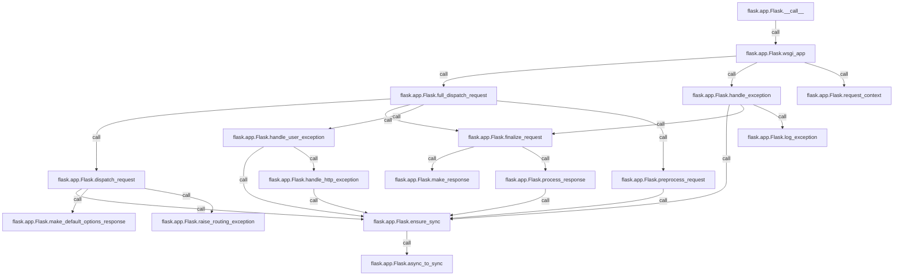

# 10 · 请求处理主流程：从 wsgi_app 到 finalize_request

> 模型生成，需人工审阅。静态推断：可达关系与源码顺序不等于运行轨迹；动态分派仍需运行验证。

## 学习目标

- 理解 Flask 应用对象作为 WSGI 可调用对象时，一次请求从 `__call__` 到 `wsgi_app` 的入口与上下文生命周期。 [Flask.__call__](src/flask/app.py:1529)
- 掌握 `full_dispatch_request` 中预处理、视图分发、异常处理与 `finalize_request` 的协作关系。 [Flask.__call__](src/flask/app.py:1529)
- 区分正常分发路径与错误处理路径，理解 `handle_user_exception`、`handle_exception` 与 `finalize_request` 的安全模式。 [Flask.__call__](src/flask/app.py:1529)

## 按调用顺序理解

WSGI 服务器把 Flask 应用对象当作可调用对象调用，`Flask.__call__` 只是把 `environ` 和 `start_response` 原样转交给 `wsgi_app`。文档说明这样拆分是为了让中间件可以包装 `wsgi_app` 而不丢失应用对象引用，因此真正的请求处理逻辑从 `wsgi_app` 开始。 [Flask.__call__](src/flask/app.py:1529) [Flask.wsgi_app](src/flask/app.py:1479)

`wsgi_app` 先用 `request_context(environ)` 构造请求上下文，然后在 `try` 中 `push` 上下文并调用 `full_dispatch_request` 得到响应，最后用 `response(environ, start_response)` 交给 WSGI 服务器。外层 `except` 捕获普通异常后交给 `handle_exception` 生成响应，而裸 `except` 记录错误后重新抛出；`finally` 中无论成功失败都会 `ctx.pop(error)`，保证上下文清理。 [Flask.wsgi_app](src/flask/app.py:1479) [Flask.request_context](src/flask/app.py:1407) [Flask.full_dispatch_request](src/flask/app.py:904) [Flask.handle_exception](src/flask/app.py:811)

`full_dispatch_request` 是请求处理的中枢：它先标记首次请求，发送 `request_started` 信号，再调用 `preprocess_request`。若预处理返回 `None` 才继续 `dispatch_request`；任何异常都被 `handle_user_exception` 转换，最终统一交给 `finalize_request` 生成响应。 [Flask.full_dispatch_request](src/flask/app.py:904) [Flask.preprocess_request](src/flask/app.py:1271) [Flask.dispatch_request](src/flask/app.py:879) [Flask.handle_user_exception](src/flask/app.py:779) [Flask.finalize_request](src/flask/app.py:922)

`preprocess_request` 按应用与蓝图顺序执行 URL 值预处理器，再执行 `before_request` 函数；任一 `before_request` 返回非 `None` 值即被当作视图返回值并停止后续处理。这些函数通过 `ensure_sync` 调用，普通函数原样返回，协程函数则经 `async_to_sync` 包装成同步可调用，从而适配 WSGI 工作进程。 [Flask.preprocess_request](src/flask/app.py:1271) [Flask.ensure_sync](src/flask/app.py:966) [Flask.async_to_sync](src/flask/app.py:980)

`dispatch_request` 负责真正的路由分发：若请求带有路由异常则调用 `raise_routing_exception`，该方法在调试模式下可能把会丢弃请求体的重定向替换为错误，否则直接抛出。若规则允许自动 OPTIONS 且方法为 OPTIONS，则返回 `make_default_options_response`；否则通过 `ensure_sync` 调用对应端点的视图函数并传入 `view_args`。 [Flask.dispatch_request](src/flask/app.py:879) [Flask.raise_routing_exception](src/flask/app.py:478) [Flask.make_default_options_response](src/flask/app.py:953) [Flask.ensure_sync](src/flask/app.py:966)

当分发或预处理抛出异常时，`handle_user_exception` 接手：对 `HTTPException` 且未被 `trap_http_exception` 拦截的情况转交 `handle_http_exception`，后者查找错误处理器，找不到则把异常本身作为响应返回；对普通异常则查找错误处理器，没有处理器就重新抛出。找到的处理器同样经 `ensure_sync` 调用。 [Flask.handle_user_exception](src/flask/app.py:779) [Flask.handle_http_exception](src/flask/app.py:744) [Flask.ensure_sync](src/flask/app.py:966)

`finalize_request` 把视图或错误处理器的返回值转成响应：先 `make_response` 处理元组、字符串、字典等返回形式，再 `process_response` 执行 `after_request` 函数并保存会话，随后发送 `request_finished` 信号。它带有 `from_error_handler` 安全模式：仅在 `process_response` 或 `request_finished` 阶段出错时记录日志而不重抛；`make_response` 位于这个 try 之前，其异常不受此保护。 [Flask.finalize_request](src/flask/app.py:922) [Flask.make_response](src/flask/app.py:1129) [Flask.process_response](src/flask/app.py:1298)

若异常逃逸到 `wsgi_app` 层，`handle_exception` 会发送 `got_request_exception` 信号，并根据 `PROPAGATE_EXCEPTIONS`（未设置时取 testing 或 debug）决定是否重新抛出。不传播时它调用 `log_exception` 记录错误，构造 `InternalServerError` 并设置 `original_exception`，若有 500 处理器则调用，最后以 `from_error_handler=True` 调用 `finalize_request`，确保错误响应也经过后处理。 [Flask.handle_exception](src/flask/app.py:811) [Flask.log_exception](src/flask/app.py:864) [Flask.finalize_request](src/flask/app.py:922)

> 图只显示前 20 个阅读节点间可解析的调用/继承边；非运行时完整轨迹。

## 关键符号速查

| 符号 | 类型 / 入口 | 出处 |
| --- | --- | --- |
| `Flask.async_to_sync` | function / — | [Flask.async_to_sync](src/flask/app.py:980) |
| `Flask.log_exception` | function / — | [Flask.log_exception](src/flask/app.py:864) |
| `Flask.make_default_options_response` | function / — | [Flask.make_default_options_response](src/flask/app.py:953) |
| `Flask.make_response` | function / — | [Flask.make_response](src/flask/app.py:1129) |
| `Flask.ensure_sync` | function / — | [Flask.ensure_sync](src/flask/app.py:966) |
| `Flask.raise_routing_exception` | function / — | [Flask.raise_routing_exception](src/flask/app.py:478) |
| `Flask.request_context` | function / — | [Flask.request_context](src/flask/app.py:1407) |
| `Flask.dispatch_request` | function / — | [Flask.dispatch_request](src/flask/app.py:879) |
| `Flask.handle_http_exception` | function / — | [Flask.handle_http_exception](src/flask/app.py:744) |
| `Flask.preprocess_request` | function / — | [Flask.preprocess_request](src/flask/app.py:1271) |
| `Flask.process_response` | function / — | [Flask.process_response](src/flask/app.py:1298) |
| `Flask.finalize_request` | function / — | [Flask.finalize_request](src/flask/app.py:922) |
| `Flask.handle_user_exception` | function / — | [Flask.handle_user_exception](src/flask/app.py:779) |
| `Flask.full_dispatch_request` | function / — | [Flask.full_dispatch_request](src/flask/app.py:904) |
| `Flask.handle_exception` | function / — | [Flask.handle_exception](src/flask/app.py:811) |
| `Flask.wsgi_app` | function / — | [Flask.wsgi_app](src/flask/app.py:1479) |
| `Flask.__call__` | function / protocol | [Flask.__call__](src/flask/app.py:1529) |

## 自测题

1. 当某个 `before_request` 函数返回非 None 值时，请求处理会如何变化？ [Flask.preprocess_request](src/flask/app.py:1271) [Flask.full_dispatch_request](src/flask/app.py:904) [Flask.finalize_request](src/flask/app.py:922)

答案：`preprocess_request` 会立即返回该值，`full_dispatch_request` 因返回值非 None 而跳过 `dispatch_request`，直接把它交给 `finalize_request` 转成响应。 [Flask.preprocess_request](src/flask/app.py:1271) [Flask.full_dispatch_request](src/flask/app.py:904) [Flask.finalize_request](src/flask/app.py:922)

2. `handle_exception` 在什么情况下会重新抛出异常，而不是返回 500 响应？ [Flask.handle_exception](src/flask/app.py:811) [Flask.log_exception](src/flask/app.py:864) [Flask.finalize_request](src/flask/app.py:922)

答案：当 `PROPAGATE_EXCEPTIONS` 为真（未设置时取 testing 或 debug）时，它会重新抛出当前异常或传入的异常；否则记录日志并构造 `InternalServerError` 走 `finalize_request`。 [Flask.handle_exception](src/flask/app.py:811) [Flask.log_exception](src/flask/app.py:864) [Flask.finalize_request](src/flask/app.py:922)

## 下一课

请求处理主流程依赖应用对象被正确构造与配置，下一课将看命令行入口如何定位应用、加载命令并启动开发服务器。 下一课：11 · 命令行入口：定位应用、加载命令并运行开发服务器。 [AppGroup.command](src/flask/cli.py:413)
