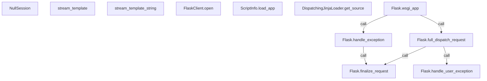

# 14 · 空会话、流式模板与请求分发流程

> 模型生成，需人工审阅。仅依据静态源码片段；图中的边表示可解析的静态关系。

## 从源码理解

- **NullSession**：NullSession 继承 SecureCookieSession，用于在未设置 secret_key 时给出更友好的错误提示。它把 __setitem__、__delitem__、clear、pop、popitem、update、setdefault 全部指向 _fail，而 _fail 会抛出 RuntimeError 说明会话不可用；因此读取空会话仍可进行，但任何写入操作都会失败。注意 _fail 在类体内被 del 删除，它只作为这些方法的实现存在。 [NullSession](src/flask/sessions.py:97)

- **stream_template**：stream_template 接收模板名（或模板对象、列表）以及上下文关键字参数，返回一个字符串迭代器，可用作视图的流式响应。它先通过 current_app 取得当前应用对象，再用 jinja_env.get_or_select_template 选出模板，最后交给 _stream 处理。片段被截断，_stream 的具体行为未展示。 [stream_template](src/flask/templating.py:188)

- **stream_template_string**：stream_template_string 与 stream_template 类似，但输入是模板源码字符串而非模板名。它取得当前应用对象，用 jinja_env.from_string 从字符串构造模板，再交给 _stream 返回字符串迭代器。片段被截断，_stream 的实现细节不可见。 [stream_template_string](src/flask/templating.py:207)

- **FlaskClient.open**：FlaskClient.open 是测试客户端的请求入口，支持 buffered 与 follow_redirects 参数。它根据第一个参数类型构造请求：EnvironBuilder 会被复制并替换 environ_base，dict 通过 EnvironBuilder.from_environ 转换，BaseRequest 则复制并替换 environ，否则用 _request_from_builder_args 构建。随后关闭旧的上下文栈、调用父类 open 发送请求、设置 response.json_module，并重新压入请求期间保留的上下文。 [FlaskClient.open](src/flask/testing.py:204)

- **Flask.finalize_request**：finalize_request 把视图返回值转换为 Response 并完成请求收尾。它先调用 make_response 转换 rv，再调用 process_response 并发送 request_finished 信号。若过程中抛异常且 from_error_handler 为假则重新抛出，否则记录日志并返回已有 response。片段被截断，docstring 后半部分未展示。 [Flask.finalize_request](src/flask/app.py:922)

- **Flask.handle_user_exception**：handle_user_exception 处理应被捕获的异常。若异常是 BadRequestKeyError 且处于 debug 或开启 TRAP_BAD_REQUEST_ERRORS，则设置 show_exception；若是 HTTPException 且未被 trap_http_exception 拦截，则转交 handle_http_exception。否则用 _find_error_handler 查找处理器，找不到就重新抛出，找到则用 ensure_sync 调用并返回其结果。 [Flask.handle_user_exception](src/flask/app.py:779)

- **ScriptInfo.load_app**：load_app 负责加载并缓存 Flask 应用，多次调用返回同一实例。若已有 _loaded_app 直接返回；否则优先调用 create_app，其次按 app_import_path 解析导入路径，最后依次尝试 wsgi.py 与 app.py。都找不到时抛出 NoAppException，若 set_debug_flag 为真则更新 app.debug，最后缓存并返回应用。 [ScriptInfo.load_app](src/flask/cli.py:333)

- **DispatchingJinjaLoader.get_source**：DispatchingJinjaLoader.get_source 是 Jinja 加载器获取模板源码的入口。它检查配置项 EXPLAIN_TEMPLATE_LOADING：为真时走 _get_source_explained 以便输出加载过程说明，否则走 _get_source_fast 快速获取。两个内部方法的具体实现未在片段中展示。 [DispatchingJinjaLoader.get_source](src/flask/templating.py:60)

- **Flask.full_dispatch_request**：full_dispatch_request 在分发请求之外还完成前后处理与异常捕获。它先标记 _got_first_request，发送 request_started 信号，调用 preprocess_request；若返回 None 则调用 dispatch_request 得到 rv。捕获异常时交给 handle_user_exception，最后统一用 finalize_request 生成响应。 [Flask.full_dispatch_request](src/flask/app.py:904)

- **Flask.handle_exception**：handle_exception 处理没有对应错误处理器或从错误处理器中抛出的异常，通常导致 500 InternalServerError。它先发送 got_request_exception 信号，依据 PROPAGATE_EXCEPTIONS（未设置时取 testing 或 debug）决定是否重新抛出。不传播时记录异常、构造 InternalServerError，查找并调用错误处理器，最后以 from_error_handler=True 调用 finalize_request。 [Flask.handle_exception](src/flask/app.py:811)

- **Flask.wsgi_app**：wsgi_app 是实际的 WSGI 应用入口，独立于 __call__ 以便中间件仍能引用应用对象。它创建请求上下文并 push，调用 full_dispatch_request 得到响应；若抛异常则记录 error 并交给 handle_exception，然后调用 response(environ, start_response)。finally 中处理调试上下文保留、忽略错误判断，并最终 ctx.pop(error)。片段被截断，开头注释未完整展示。 [Flask.wsgi_app](src/flask/app.py:1479)

## 本课静态关系

> 孤立节点表示本课范围内没有解析到连边；不代表运行时无联系。
