# 17 · 蓝图机制：延迟记录与注册时展开

> 模型生成，需人工审阅。静态推断：可达关系与源码顺序不等于运行轨迹；动态分派仍需运行验证。

## 学习目标

- 理解 Blueprint 如何通过 deferred_functions 延迟记录路由、模板与请求钩子，而不需要应用对象即可定义功能 [BlueprintSetupState.__init__](src/flask/sansio/blueprints.py:41)
- 掌握注册时 BlueprintSetupState 如何携带选项与 first_registration 标志，把延迟函数展开到应用上 [BlueprintSetupState.__init__](src/flask/sansio/blueprints.py:41)

## 按调用顺序理解

蓝图的核心思想是“先定义、后绑定”：`Blueprint` 类文档说明它允许在没有应用对象时定义应用功能，通过记录装饰器产生的延迟函数，等到注册时再执行。构造函数 `Blueprint.__init__` 校验 name 非空且不含点号，保存 url_prefix、subdomain、url_defaults，并初始化关键容器 `deferred_functions` 列表，这就是所有延迟记录的落点。 [Blueprint](src/flask/sansio/blueprints.py:119) [Blueprint.__init__](src/flask/sansio/blueprints.py:174)

记录机制由 `record` 与 `record_once` 两个方法构成。`record` 只是把函数追加到 `deferred_functions`，文档说明该函数在蓝图注册时以 setup state 为参数被调用。`record_once` 则用 `wrapper` 包裹原函数，仅当 `state.first_registration` 为真时才执行，从而避免同一蓝图在同一个应用中重复注册这些操作；换一个应用仍会执行该应用的首次注册；它最终仍通过 `record` 入列。 [Blueprint.record](src/flask/sansio/blueprints.py:224) [Blueprint.record_once](src/flask/sansio/blueprints.py:233) [Blueprint.record_once.wrapper](src/flask/sansio/blueprints.py:240)

路由注册走的是 `record` 路径：`Blueprint.add_url_rule` 先校验 endpoint 与视图函数名不含点号，然后记录一个 lambda，该 lambda 在注册时调用 setup state 的 `add_url_rule`。真正的 URL 前缀拼接、endpoint 前缀化与 subdomain 默认值都在 `BlueprintSetupState.add_url_rule` 中完成，它把 `url_prefix` 与规则合并，并以 `name_prefix.name.endpoint` 形式调用应用的 `add_url_rule`。 [Blueprint.add_url_rule](src/flask/sansio/blueprints.py:413) [BlueprintSetupState.add_url_rule](src/flask/sansio/blueprints.py:87)

模板相关的 app 级注册采用 `record_once`：`add_app_template_filter`、`add_app_template_test`、`add_app_template_global` 各自定义内部 `register_template`，在注册时把函数写入 `state.app.jinja_env` 的 filters、tests、globals。对应的装饰器形式 `app_template_filter`、`app_template_test`、`app_template_global` 只是转调这些 add 方法并返回原函数，因此装饰器与直接调用共享同一条延迟记录路径。 [Blueprint.add_app_template_filter](src/flask/sansio/blueprints.py:461) [Blueprint.add_app_template_filter.register_template](src/flask/sansio/blueprints.py:472) [Blueprint.add_app_template_test](src/flask/sansio/blueprints.py:497) [Blueprint.add_app_template_test.register_template](src/flask/sansio/blueprints.py:510) [Blueprint.add_app_template_global](src/flask/sansio/blueprints.py:535) [Blueprint.add_app_template_global.register_template](src/flask/sansio/blueprints.py:548) [Blueprint.app_template_filter](src/flask/sansio/blueprints.py:444) [Blueprint.app_template_filter.decorator](src/flask/sansio/blueprints.py:454) [Blueprint.app_template_test](src/flask/sansio/blueprints.py:478) [Blueprint.app_template_test.decorator](src/flask/sansio/blueprints.py:490) [Blueprint.app_template_global](src/flask/sansio/blueprints.py:516) [Blueprint.app_template_global.decorator](src/flask/sansio/blueprints.py:528)

请求钩子与错误处理同样以 `record_once` 记录：`before_app_request`、`after_app_request`、`teardown_app_request`、`app_context_processor`、`app_url_defaults`、`app_url_value_preprocessor` 都在注册时把函数追加到应用对应字典的 None 键下，表示注册到应用层；请求钩子、URL 处理和模板上下文处理各在自己的阶段生效。`app_errorhandler` 返回装饰器，其内部 `from_blueprint` 在注册时调用 `state.app.errorhandler(code)(f)`，从而把处理器挂到应用级。 [Blueprint.before_app_request](src/flask/sansio/blueprints.py:554) [Blueprint.after_app_request](src/flask/sansio/blueprints.py:564) [Blueprint.teardown_app_request](src/flask/sansio/blueprints.py:574) [Blueprint.app_context_processor](src/flask/sansio/blueprints.py:584) [Blueprint.app_url_defaults](src/flask/sansio/blueprints.py:625) [Blueprint.app_url_value_preprocessor](src/flask/sansio/blueprints.py:613) [Blueprint.app_errorhandler](src/flask/sansio/blueprints.py:596) [Blueprint.app_errorhandler.decorator](src/flask/sansio/blueprints.py:603) [Blueprint.app_errorhandler.decorator.from_blueprint](src/flask/sansio/blueprints.py:604)

注册阶段由 `Blueprint.register` 驱动：它计算带 name_prefix 的最终名称，检查重名，标记 `_got_registered_once`，再通过 `make_setup_state` 创建 `BlueprintSetupState`。该状态对象保存 app、blueprint、options 与 `first_registration`，并从 options 或蓝图默认值解析 subdomain、url_prefix、name、url_defaults。随后 register 遍历 `deferred_functions` 逐个以 state 调用，完成从延迟记录到实际注册的展开。 [Blueprint.register](src/flask/sansio/blueprints.py:273) [Blueprint.make_setup_state](src/flask/sansio/blueprints.py:246) [BlueprintSetupState](src/flask/sansio/blueprints.py:34) [BlueprintSetupState.__init__](src/flask/sansio/blueprints.py:41)

注册时还会合并蓝图自身收集的钩子与视图：`_merge_blueprint_funcs` 用内部 `extend` 把 before/after/teardown 请求函数、url_defaults、url_value_preprocessors、template_context_processors 以带前缀的键并入应用字典，并复制 error_handler_spec 与 view_functions。嵌套蓝图通过 `register_blueprint` 仅把子蓝图与选项追加到 `_blueprints` 列表，真正的展开发生在父蓝图注册时。此外 `_check_setup_finished` 在已注册后阻止继续调用 setup 方法，保证延迟记录的一致性。 [Blueprint._merge_blueprint_funcs](src/flask/sansio/blueprints.py:379) [Blueprint._merge_blueprint_funcs.extend](src/flask/sansio/blueprints.py:380) [Blueprint.register_blueprint](src/flask/sansio/blueprints.py:256) [Blueprint._check_setup_finished](src/flask/sansio/blueprints.py:213)

```mermaid
flowchart TD
  ncaa44e57c8be1ecb["flask.sansio.blueprints.BlueprintSetupState.__init__"]
  n2701011048f50e79["flask.sansio.blueprints.Blueprint.__init__"]
  n8a5c90efd2a5607e["flask.sansio.blueprints.BlueprintSetupState.add_url_rule"]
  n98140aeb03b18fde["flask.sansio.blueprints.Blueprint"]
  n5f65e4ea3c8c9b8a["flask.sansio.blueprints.Blueprint._check_setup_finished"]
  ndea4d5cdde3d9318["flask.sansio.blueprints.Blueprint.record_once.wrapper"]
  n984c0f320d59e480["flask.sansio.blueprints.Blueprint.register_blueprint"]
  n98f15e357cf0bb53["flask.sansio.blueprints.Blueprint.register"]
  n00af4a4cd5ebcb2f["flask.sansio.blueprints.Blueprint.make_setup_state"]
  ndcaecf900e3d6ab6["flask.sansio.blueprints.BlueprintSetupState"]
  n40894ac0f96a5b2c["flask.sansio.blueprints.Blueprint._merge_blueprint_funcs"]
  ne9ce1492cb5a1fa2["flask.sansio.blueprints.Blueprint._merge_blueprint_funcs.extend"]
  nd7d5ad2591db0c95["flask.sansio.blueprints.Blueprint.add_url_rule"]
  nc963ce44a27ed603["flask.sansio.blueprints.Blueprint.record"]
  nf58dd1a8f37ae106["flask.sansio.blueprints.Blueprint.app_template_filter"]
  nd5c9f708a9db2a10["flask.sansio.blueprints.Blueprint.app_template_filter.decorator"]
  n7919e98861d11810["flask.sansio.blueprints.Blueprint.add_app_template_filter"]
  nf9a11a35b5c987ff["flask.sansio.blueprints.Blueprint.record_once"]
  ne266eda422835635["flask.sansio.blueprints.Blueprint.add_app_template_filter.register_template"]
  ndc4ac55454f4fe53["flask.sansio.blueprints.Blueprint.app_template_test"]
  n7919e98861d11810 -->|call| nf9a11a35b5c987ff
  nd7d5ad2591db0c95 -->|call| nc963ce44a27ed603
  n00af4a4cd5ebcb2f -->|call| ndcaecf900e3d6ab6
  nf9a11a35b5c987ff -->|call| nc963ce44a27ed603
  n98f15e357cf0bb53 -->|call| n40894ac0f96a5b2c
  n98f15e357cf0bb53 -->|call| n00af4a4cd5ebcb2f
```

> 图只显示前 20 个阅读节点间可解析的调用/继承边；非运行时完整轨迹。

## 关键符号速查

| 符号 | 类型 / 入口 | 出处 |
| --- | --- | --- |
| `Blueprint.__init__` | function / constructor | [Blueprint.__init__](src/flask/sansio/blueprints.py:174) |
| `Blueprint.add_app_template_filter.register_template` | function / — | [Blueprint.add_app_template_filter.register_template](src/flask/sansio/blueprints.py:472) |
| `Blueprint.add_app_template_global.register_template` | function / — | [Blueprint.add_app_template_global.register_template](src/flask/sansio/blueprints.py:548) |
| `Blueprint.add_app_template_test.register_template` | function / — | [Blueprint.add_app_template_test.register_template](src/flask/sansio/blueprints.py:510) |
| `Blueprint.app_errorhandler.decorator.from_blueprint` | function / — | [Blueprint.app_errorhandler.decorator.from_blueprint](src/flask/sansio/blueprints.py:604) |
| `Blueprint.app_errorhandler.decorator` | function / — | [Blueprint.app_errorhandler.decorator](src/flask/sansio/blueprints.py:603) |
| `Blueprint.app_errorhandler` | function / — | [Blueprint.app_errorhandler](src/flask/sansio/blueprints.py:596) |
| `Blueprint.app_template_filter.decorator` | function / — | [Blueprint.app_template_filter.decorator](src/flask/sansio/blueprints.py:454) |
| `Blueprint.app_template_filter` | function / — | [Blueprint.app_template_filter](src/flask/sansio/blueprints.py:444) |
| `Blueprint.app_template_global.decorator` | function / — | [Blueprint.app_template_global.decorator](src/flask/sansio/blueprints.py:528) |
| `Blueprint.app_template_global` | function / — | [Blueprint.app_template_global](src/flask/sansio/blueprints.py:516) |
| `Blueprint.app_template_test.decorator` | function / — | [Blueprint.app_template_test.decorator](src/flask/sansio/blueprints.py:490) |
| `Blueprint.app_template_test` | function / — | [Blueprint.app_template_test](src/flask/sansio/blueprints.py:478) |
| `Blueprint.record` | function / — | [Blueprint.record](src/flask/sansio/blueprints.py:224) |
| `Blueprint.record_once.wrapper` | function / — | [Blueprint.record_once.wrapper](src/flask/sansio/blueprints.py:240) |
| `Blueprint.register_blueprint` | function / — | [Blueprint.register_blueprint](src/flask/sansio/blueprints.py:256) |
| `BlueprintSetupState.__init__` | function / constructor | [BlueprintSetupState.__init__](src/flask/sansio/blueprints.py:41) |
| `BlueprintSetupState` | class / — | [BlueprintSetupState](src/flask/sansio/blueprints.py:34) |
| `Blueprint.add_url_rule` | function / — | [Blueprint.add_url_rule](src/flask/sansio/blueprints.py:413) |
| `Blueprint.make_setup_state` | function / — | [Blueprint.make_setup_state](src/flask/sansio/blueprints.py:246) |
| `Blueprint.record_once` | function / — | [Blueprint.record_once](src/flask/sansio/blueprints.py:233) |
| `Blueprint` | class / — | [Blueprint](src/flask/sansio/blueprints.py:119) |
| `BlueprintSetupState.add_url_rule` | function / — | [BlueprintSetupState.add_url_rule](src/flask/sansio/blueprints.py:87) |
| `Blueprint.add_app_template_filter` | function / — | [Blueprint.add_app_template_filter](src/flask/sansio/blueprints.py:461) |
| `Blueprint.add_app_template_global` | function / — | [Blueprint.add_app_template_global](src/flask/sansio/blueprints.py:535) |
| `Blueprint.add_app_template_test` | function / — | [Blueprint.add_app_template_test](src/flask/sansio/blueprints.py:497) |
| `Blueprint.after_app_request` | function / — | [Blueprint.after_app_request](src/flask/sansio/blueprints.py:564) |
| `Blueprint.app_context_processor` | function / — | [Blueprint.app_context_processor](src/flask/sansio/blueprints.py:584) |
| `Blueprint.app_url_defaults` | function / — | [Blueprint.app_url_defaults](src/flask/sansio/blueprints.py:625) |
| `Blueprint.app_url_value_preprocessor` | function / — | [Blueprint.app_url_value_preprocessor](src/flask/sansio/blueprints.py:613) |
| `Blueprint.before_app_request` | function / — | [Blueprint.before_app_request](src/flask/sansio/blueprints.py:554) |
| `Blueprint.register` | function / — | [Blueprint.register](src/flask/sansio/blueprints.py:273) |
| `Blueprint.teardown_app_request` | function / — | [Blueprint.teardown_app_request](src/flask/sansio/blueprints.py:574) |

## 自测题

1. 为什么 add_url_rule 使用 record 而 before_app_request 使用 record_once？ [Blueprint.add_url_rule](src/flask/sansio/blueprints.py:413) [Blueprint.before_app_request](src/flask/sansio/blueprints.py:554) [Blueprint.record_once.wrapper](src/flask/sansio/blueprints.py:240)

答案：add_url_rule 记录的路由需要在每次注册时都展开到应用（可能以不同名称多次注册），因此用 record；而 before_app_request 等 app 级钩子在同一个应用中只应挂载一次，record_once 通过 first_registration 判断避免重复注册。 [Blueprint.add_url_rule](src/flask/sansio/blueprints.py:413) [Blueprint.before_app_request](src/flask/sansio/blueprints.py:554) [Blueprint.record_once.wrapper](src/flask/sansio/blueprints.py:240)

2. BlueprintSetupState 在注册流程中承担什么职责？ [BlueprintSetupState.__init__](src/flask/sansio/blueprints.py:41) [Blueprint.make_setup_state](src/flask/sansio/blueprints.py:246) [Blueprint.register](src/flask/sansio/blueprints.py:273) [BlueprintSetupState.add_url_rule](src/flask/sansio/blueprints.py:87)

答案：它由 make_setup_state 创建，携带 app、blueprint、options 与 first_registration，并解析 subdomain、url_prefix、name 与 url_defaults；register 把它传给每个延迟函数，add_url_rule 等方法据此把带前缀的规则和钩子写入应用。 [BlueprintSetupState.__init__](src/flask/sansio/blueprints.py:41) [Blueprint.make_setup_state](src/flask/sansio/blueprints.py:246) [Blueprint.register](src/flask/sansio/blueprints.py:273) [BlueprintSetupState.add_url_rule](src/flask/sansio/blueprints.py:87)

## 下一课

理解了蓝图如何延迟记录并在注册时展开后，下一课将转向测试工具，看环境构建器、测试客户端与 CLI 运行器如何支撑验证这些注册结果。 下一课：18 · 测试工具：环境构建器、测试客户端与 CLI 运行器。 [EnvironBuilder.__init__](src/flask/testing.py:49)
